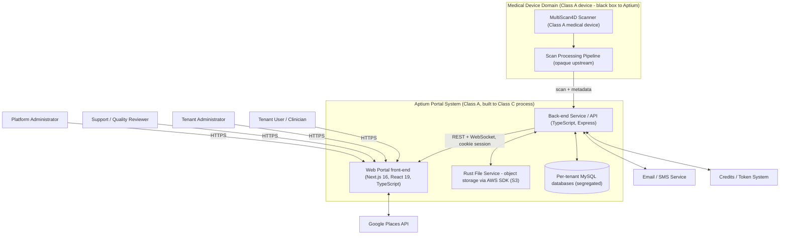
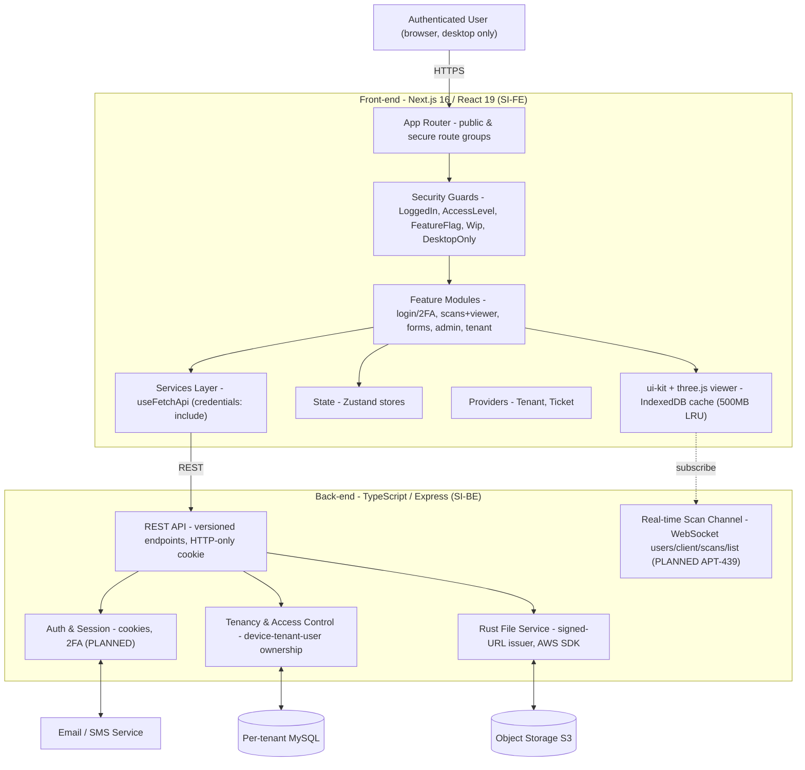
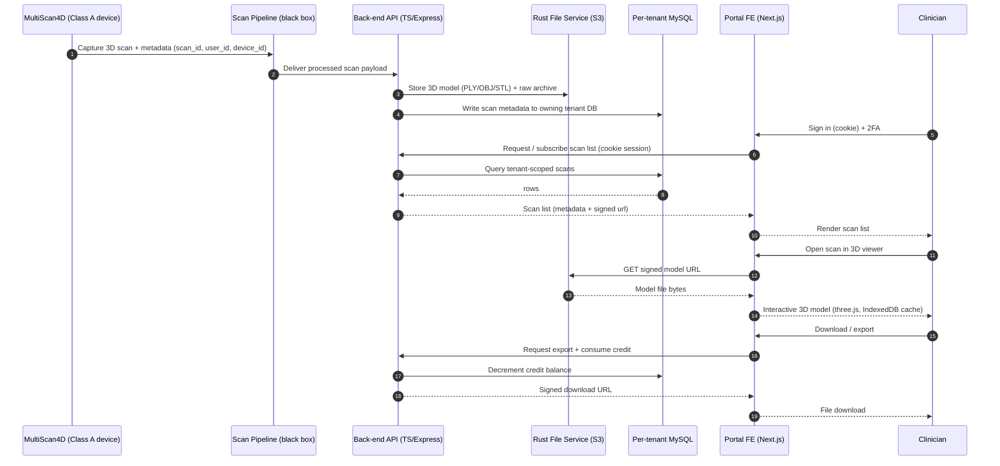
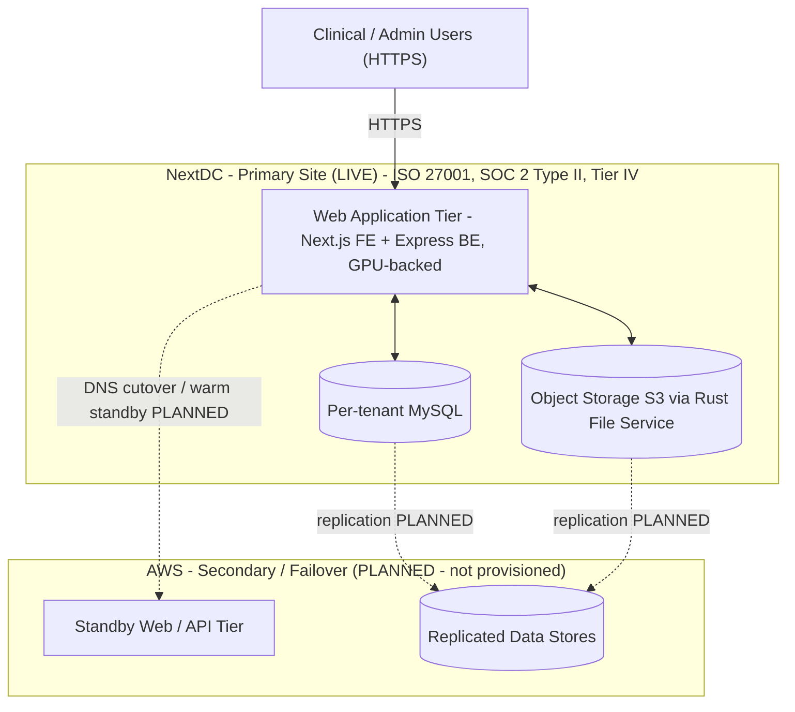

# APT-DOC-009 — Architecture diagrams for Lucid import

Paste each block below into Lucid via **Insert → More shapes / Import → Mermaid** (or the Mermaid import panel), one diagram at a time.

---

## Figure 1 — System Context

---

## Figure 2 — Container / Component Decomposition

---

## Figure 3 — Scan Data Flow

---

## Figure 4 — Deployment / Availability View

> Recovery baseline (company DR plan v1.2): RTO 72h, RPO 24h. No automated failover today; relies on NextDC resilience + backups. Deployment runbook: APT-45.
